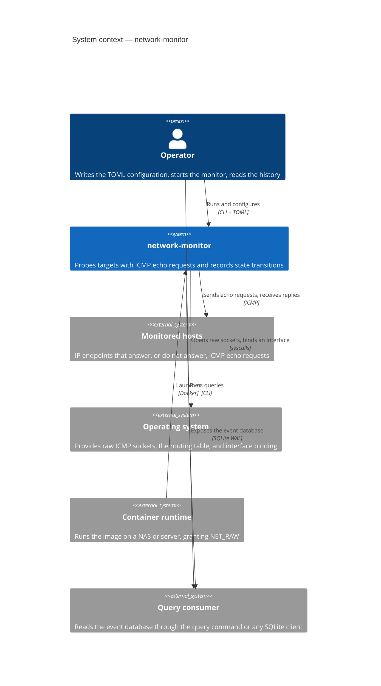
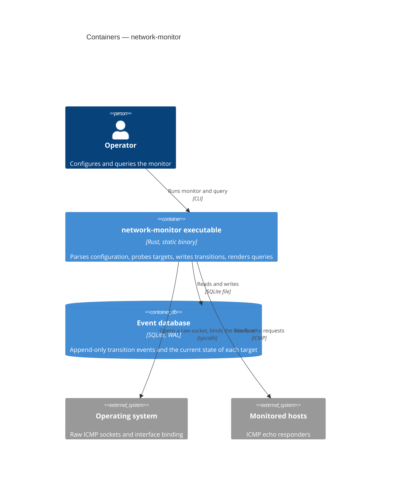
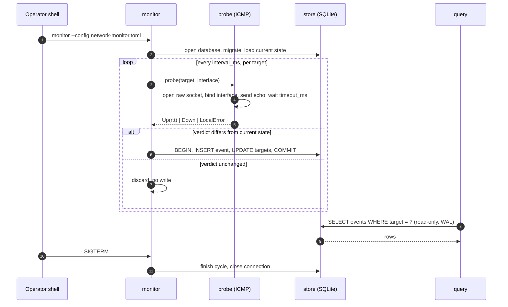

# Architecture — network-monitor

This document follows [arc42](https://arc42.org) and uses C4 diagrams. Product intent
lives in [PRODUCT.md](./PRODUCT.md); decisions and their rationale live in
[ADR.md](./ADR.md).

## 1. Introduction and goals

`network-monitor` is a single-process Rust command-line program. One invocation is either a long-running `monitor` that owns the ICMP probing loop and the SQLite writer, or a short-lived `query` that reads the same database concurrently in WAL mode.

Top quality goals, in order:

1. **Portability without dependencies.** One statically linked executable runs on macOS, Linux, and Windows; nothing else must be installed on the host or in the container.
2. **Storage proportional to incidents.** Only state transitions are persisted, so a month of monitoring costs kilobytes.
3. **Interface-accurate reachability.** A probe bound to `eth1` measures `eth1`, with the semantics of `ping -I eth1`.
4. **Queryable while running.** Reading the history never requires stopping the monitor and never blocks it.
5. **Testability without privileges.** The prober sits behind a contract, so the state machine, the store, and the queries are tested with a fake and no raw sockets.

## 2. Constraints

- **Language and toolchain.** Rust stable, edition 2021, MSRV declared in `Cargo.toml` (1.75 or newer).
- **Static linkage.** `rusqlite` with the `bundled` feature compiles SQLite into the binary; Linux releases are built for `x86_64-unknown-linux-musl`. No system library may be required at run time.
- **Privileges.** Raw ICMP sockets need `root`, `CAP_NET_RAW`, or Administrator on Windows. The container requests only `NET_RAW` and drops every other capability.
- **Platform interface binding.** `SO_BINDTODEVICE` on Linux, `IP_BOUND_IF` on macOS, `IP_UNICAST_IF` on Windows (by numeric interface index).
- **Filesystem.** The SQLite file must live on a local filesystem; WAL on SMB or NFS shares is not supported and is documented as such.
- **Synchronous design.** No async runtime, no daemon framework, no plugin system. Threads are used per target, and that is the whole concurrency model.
- **No listening socket.** The process opens no port; the only integration surface is the SQLite file and the query command.
- **Language of the repository.** English only, for every artefact.

## 3. Context and scope



| External element | Input to the system | Output from the system |
|---|---|---|
| Operator | Configuration file, command-line options, signals | Human-readable logs on stderr, exit codes, query output |
| Monitored hosts | ICMP echo replies, or nothing | ICMP echo requests, one per target per interval |
| Operating system | Raw socket capability, routing table, interface list, clock | Socket creation and bind calls, packets |
| Container runtime | Process launch, `NET_RAW` capability, mounted configuration and volume | Exit status, log stream |
| Query consumer | Read-only SQL or `query` invocations | Rows and reports |

Trust boundaries: the database file is written only by the `monitor` process and read by anyone with filesystem access to it; the raw socket capability is the only privileged operation. No external service is trusted and none is required.

## 4. Solution strategy

- **One binary, two verbs.** `monitor` and `query` share the configuration, the schema, and the process image. Deployment is one artifact; the query path opens the database read-only and cannot repair it.
- **Event-only persistence with a current-state projection.** An append-only `events` table holds transitions; a `targets` table holds the current state and the last probe outcome. The writer updates both in one transaction, so a reader never sees a state that contradicts the latest event.
- **Layered configuration as data.** Defaults, file, and command line are merged into one immutable effective configuration before anything else runs; each layer is a pure function with a test.
- **Probe behind a contract.** `Probe::probe(target, interface) -> Result<Verdict, ProbeError>` separates the transport from the decision. `Verdict::{Up, Down}` answers "the peer is silent"; `ProbeError::Local` answers "the host cannot probe". The type system keeps the two apart.
- **Platform code isolated in one module.** Only `probe/interface` knows about `SO_BINDTODEVICE`, `IP_BOUND_IF`, and `IP_UNICAST_IF`; the rest of the code is platform-independent.
- **Thread per target, shared store.** Each target runs its own interval loop; transitions are serialized through one SQLite writer connection, guarded by a mutex.
- **WAL for concurrent reads.** `journal_mode = WAL` with `synchronous = NORMAL` and a 5 s `busy_timeout` lets the query process read while the monitor writes.
- **Supervised reload.** The supervisor owns the set of workers and compares the configuration file content once per second. A valid change restarts the workers with the new target list, interval, and timeout, keeps the database it already opened, and logs one `INFO` line.
- **Read-only page generated server-side.** `web` answers `/` with HTML and SVG built in Rust from the same timeline query the CLI uses, and `/target` with one bar per day and the same days in a table for a single target. One small HTTP/1.1 loop, no framework, no client-side chart library and no client-side chart state: the browser reloads the page every 30 s and asks for nothing else. The same code serves while the monitor runs (`monitor --listen`) and without probing (`serve`), so a page and the recording share one process when both are wanted.

<!-- skill:block:arch-principles section="## 4. Solution strategy" -->
### Architecture principles

Fixed principles that constrain every design decision and every change:

- **Simplicity first (KISS).** The architecture is the simplest one that satisfies the
  requirements: the fewest components, layers, dependencies, and configuration knobs
  that work. Complexity is admitted only with a documented constraint and recorded in
  [ADR.md](./ADR.md).
- **Modular by default.** The system is split into modules with one responsibility
  each, behind a published contract. Modules are independently testable, independently
  evolvable, and independently debuggable: no dependency on another module's
  internals, no dependency cycles, no change that ripples across unrelated modules.
- **Tests with every change.** Every development effort ships with the tests of the
  part it touches. Testability is an architectural property: a module that cannot be
  tested in isolation, without starting the others, is not modular enough.
<!-- skill:end:arch-principles -->

## 5. Building block view



| Component | Responsibility | Published contract |
|---|---|---|
| `cli` | Parse the command line, dispatch the subcommand, map every option to a configuration override, set the exit code | `clap` definition, `Command` enum |
| `config` | Load the TOML file, validate it, merge defaults, file, and overrides into one effective configuration | `Config`, `TargetSpec`, `ConfigError` |
| `probe` | Execute one ICMP echo request for a target through an interface and classify the outcome | `Probe` trait, `Verdict`, `ProbeError` |
| `probe::interface` | Resolve an interface name to the platform handle and bind the socket to it | `bind_socket(fd, interface)` per platform |
| `monitor` | Supervise one interval loop per target, decide whether a transition occurred, reload the configuration file, dispatch transitions to the store | `run(config, prober, store, shutdown, reload)` |
| `reload` | Compare the configuration file with the last accepted content and report a change | `Watcher`, `Change`, `POLL_INTERVAL` |
| `web` | Serve the read-only timeline, the per-target detail page, and a health check | `bind`, `serve`, `page`, `target_page` |
| `store` | Own the schema, migrations, the event write transaction, retention, and the read queries | `Store`, `Event`, `TargetState`, `DownEpisode`, `ExportedEvent`, `StoreError` |
| `query` | Read current state and event history, apply filters, render a table or JSON | `QueryFilter`, `Renderer` |
| `import` | Restore a history from the exported CSV, read from a path, an `http://` URL, or stdin | `run`, `parse_source`, `Report`, `ImportError` |

### Component contracts

### `config`

- **Input:** an optional TOML file and the command-line overrides.
- **Output:** an immutable `Config` with global defaults resolved and every target validated, or a `ConfigError` naming the offending key.
- **Guarantees:** the merge order is `command line > file > default`; no value is invented at probe time; validation (positive interval and timeout, parseable IP, existing interface when privileged checks are possible) happens before the first probe.

### `probe`

- **Input:** a target address and an optional interface name.
- **Output:** `Verdict::Up { rtt }`, `Verdict::Down`, or `ProbeError::Local { reason }`.
- **Guarantees:** one echo request per call; the wait is bounded by `timeout_ms`; a reply from a different address or with a different identifier is discarded; a local failure (socket, permission, interface) is never reported as `Down`.

### `store`

- **Input:** transitions from the monitor, retention commands, read queries.
- **Output:** persisted rows, or `StoreError`.
- **Guarantees:** a transition writes the event and the current state in one transaction; the schema is created and migrated on open; a database from a newer schema version is refused; the writer connection is the only writer in the process.

### `query`

- **Input:** a filter (target, time range, limit) and an output format.
- **Output:** a table or JSON document on stdout, or an error on stderr with a non-zero exit code.
- **Guarantees:** the database is opened read-only; the command works while the monitor holds a write transaction; the JSON shape is stable enough to be parsed by scripts.

### `monitor`

- **Input:** the effective configuration, a `Probe` implementation, a `Store`, a `Shutdown` handle, and optionally the path to re-read.
- **Output:** database writes, log lines, and a process exit status.
- **Guarantees:** at most one in-flight probe per target; a transition is written at most once per cycle; shutdown on `SIGINT` or `SIGTERM` happens between two cycles, never inside a transaction; a reload is applied only when the new file parses and resolves to at least one target, and the database path in use never changes at runtime.

### `reload`

- **Input:** the path of the configuration file, polled once per second.
- **Output:** `Change::Content(bytes)` when the file differs from the last accepted content, `Change::ReadError` once when it cannot be read.
- **Guarantees:** the initial content is never reported as a change; identical content is not a change; a missing or unreadable file is reported once, not on every poll.

### `web`

- **Input:** the database path and an optional `window`/`from`/`to`/`target` query string; a bound listener in tests.
- **Output:** the timeline page with one lane per target — drops, down time, the average `up` run with its spread, how long the target has been up without a drop, and the availability, in that order, the statistics computed by `web::stats` from the same segments that draw the bands, the streak from the age of the current state in the `targets` table — plus the last 10 disconnections; the detail page of one target — opened with a breadcrumb that leads back to the timeline, then its per-day chart, labelled with the count of every bar, and a per-day table of disconnections, down time, and average `up` run — ; a streamed gzipped CSV of every event, a plain-text health check, or a plain-text error. The CSV columns are `target,label,interface,state,occurred_at,rtt_us`: the same file the import reads back.
- **Guarantees:** every request opens the database read-only; a statistic is derived from the rendered segments only, with an `up` run clipped by the window counted as it appears and `unknown` time left out of the availability, so a figure can never disagree with the chart above it; only `GET` and `HEAD` are answered; dynamic text is HTML-escaped; the window is one of the offered spans — 1, 2, 4, 6, 12, or 24 hours, 1 by default, an unknown `window` falling back to the default — clamped to the last 30 days and never past now; every instant is emitted in UTC (`<time datetime>`, `data-datetime`) and formatted by the browser with `Intl`, so the server needs neither a locale nor a time zone and a page is identical for every reader; nothing is written, and the socket exists only while the process that bound it runs. The export is streamed as HTTP chunks and deflated on the fly, in pages of 1 000 events: the response holds no copy of the file and no long read transaction.

### `import`

- **Input:** the database path and a source string — a path, an `http://` URL, or `-`.
- **Output:** a `Report` with the number of events written, the number of rows ignored, the number of targets, and the detected format.
- **Guarantees:** the archive is the format the page exports, one row per event, gzipped or plain, detected from the first two bytes; the older disconnection-only header is refused with a message; events are batched into one transaction per 500 rows; an event already present is not written twice; the rows may arrive in any order, because after the writes one pass driven by the timestamps drops the events that repeat the state before them (BR-1) and points every event at the state it really replaced; the target projection, labels and interfaces included, is then rebuilt from the events.
- **Replace mode:** with `--replace-window` the archive is read once to find the window it covers, every event inside that window is deleted, the archive is applied in a second pass over the same bytes — standard input and an URL are spooled to a temporary file next to the database, so both passes see the same content — and the target projection is rebuilt from the events that remain. The state before the window seeds the `previous_state` of the first imported event.

### Data model

Two tables, owned exclusively by the `store` component. Timestamps are UTC epoch milliseconds.

```sql
PRAGMA journal_mode = WAL;
PRAGMA synchronous  = NORMAL;
PRAGMA busy_timeout = 5000;

CREATE TABLE IF NOT EXISTS schema_meta (
    version INTEGER NOT NULL
);

CREATE TABLE IF NOT EXISTS events (
    id             INTEGER PRIMARY KEY AUTOINCREMENT,
    target         TEXT    NOT NULL,   -- IP address, canonical form
    interface      TEXT,               -- null when the default route was used
    previous_state TEXT    NOT NULL,   -- 'unknown' | 'up' | 'down'
    state          TEXT    NOT NULL,   -- 'up' | 'down'
    occurred_at_ms INTEGER NOT NULL,   -- UTC epoch milliseconds
    rtt_us         INTEGER             -- null when state is 'down'
);

CREATE INDEX IF NOT EXISTS events_target_time
    ON events (target, occurred_at_ms);

CREATE TABLE IF NOT EXISTS targets (
    target            TEXT PRIMARY KEY,
    interface         TEXT,
    label             TEXT,
    current_state     TEXT    NOT NULL,   -- 'unknown' | 'up' | 'down'
    first_seen_at_ms  INTEGER NOT NULL,
    last_change_at_ms INTEGER NOT NULL,
    last_rtt_us       INTEGER
);
```

- **Ownership:** only the `store` component reads or writes these tables. The `query` component goes through the same module, with a read-only connection.
- **Retention:** the job deletes from `events` only. It never deletes a `targets` row, so a target keeps its current state and its last transition time.
- **Migrations:** `schema_meta.version` is compared on open. An older database is migrated forward step by step; a newer one is refused (BR-9).

## 6. Runtime view

The main flow: an operator starts the monitor, a target stops answering, and a second process reads the transition while monitoring continues.



Takeaway: the write path is one transaction per transition, and the read path never waits for the probing loop.

## 7. Deployment view

- **Local development.** `cargo run -- monitor --config ./network-monitor.toml`, database at `./network-monitor.db`, raw sockets through `sudo` on macOS and Linux or an elevated shell on Windows.
- **Bare host.** The release binary copied anywhere on `PATH`, the configuration in `/etc/network-monitor/config.toml`, the database in `/var/lib/network-monitor/events.db`, supervised by systemd, launchd, or the Windows scheduler. The binary requires `CAP_NET_RAW` or `root`.
- **Container.** A multi-stage image builds the static musl binary and copies it onto a minimal base, together with a default configuration that probes the container's loopback so a bare `docker run` starts. The build uses the `release-dev` profile (thin LTO, parallel codegen) and a cached `target` directory, so a source change does not recompile every dependency; `PROFILE=release` produces the published artifact. The process runs as the container user with `--cap-drop ALL --cap-add NET_RAW`, the configuration mounted read-only over the default when real targets are needed, and a volume for the database. No port is published: the page, when the command adds `--listen`, binds the host address directly through host networking. Host networking (`network_mode: host`) is required when a target is bound to a physical interface, because a bridge container only sees its own `eth0`.
- **QNAP Container Station.** A project from [docker-compose.yml](../docker-compose.yml) that pulls the image, mounts `/share/Container/network-monitor/config.toml` read-only and `/share/Container/network-monitor/data` as the database volume, with restart policy `unless-stopped` and host networking. The volume must be a local share, not a network share. Build and deployment — including a Docker context that points at the NAS so the image is built there — are in [DEVELOPER-GUIDE.md](./DEVELOPER-GUIDE.md#container-and-qnap-deployment).
- **Configuration sources.** The TOML file, then the command line; the container passes the latter through the compose `command` field. There is no environment-variable layer.
- **Upgrades.** Replace the binary or image and restart. The schema is migrated on open; a rollback to an older binary against a newer schema is refused, so the database must be backed up before a downgrade. `import` restores the disconnection history into a fresh database after a redeploy: it does not know the labels and the interfaces, which the next probe of the monitor writes back from the configuration.
- **Web page.** The same process that probes can serve the page: `monitor --config … --database … --listen 0.0.0.0:8642`. With host networking the listener needs no published port and shares the volume it is already writing. `serve --listen … --database …` remains the option for a viewer that must not have `NET_RAW`; it reads the same volume and can run on another host.

## 8. Cross-cutting concepts

### Error handling

Typed errors with `thiserror`. Startup errors (configuration, privileges, unwritable database) are fatal: one stderr line and a non-zero exit code. Probe-local errors are logged and retried on the next cycle without touching the state (BR-4). Database errors during operation are logged at `error` level; a store that cannot write stops the monitor rather than losing transitions silently.

### Logging

Line-based output on stderr, never stdout: stdout carries only query results, so a query can be piped into `jq`. Format: `<RFC 3339 timestamp> <LEVEL> [<target>] <message>`. Transitions are logged at `info`, every probe cycle at `debug`, local probe failures at `warn`, fatal conditions at `error`. The level comes from `--log-level` and defaults to `info`.

### Security

The only privileged operation is opening the raw socket; the container keeps only `NET_RAW` and drops everything else. The database is created with mode `0600`. The configuration may contain addresses and interface names but no secret. Probes are generated by this process, so no input from the network is parsed as a command.

`web` is the only component that listens, and only when `--listen` is given. It answers `GET` and `HEAD` on three paths, escapes every dynamic value, sets `nosniff` and `no-store`, and never writes. It has **no authentication**: the default bind of `serve` is `127.0.0.1`, the monitor binds nothing unless asked, and exposing the page on a LAN is a deliberate operator decision that must be paired with a firewall rule. The export path is a bulk read of the whole history, so a firewall rule protects the contents of the database as much as the page itself.

### Configuration

Three layers merged in a fixed order: built-in defaults, TOML file, command line. The result is validated once and printed by `--show-config`. Keys are stable; a removed key is a breaking change recorded in [ADR.md](./ADR.md). The annotated example lives in [README.md](../README.md#quick-start).

While monitoring runs, the file is polled once per second and a valid change is applied to the interval, timeout, target list, and retention, keeping the command line overrides on top (INV-2). An unreadable, unparseable, or target-less file is rejected with a warning and the running configuration stays active (INV-9). A changed `database` is reported and takes effect only at the next start.

### Data ownership

The `store` component owns the schema, the migration order, and every statement. No other component issues SQL. The `query` component uses read-only access and cannot repair, migrate, or compact a database.

## 9. Architecture decisions

See [ADR.md](./ADR.md). Decisions are recorded there and are not duplicated here.

## 10. Quality requirements

| Attribute | Scenario | Target | Verified by |
|---|---|---|---|
| Storage efficiency | 20 targets monitored for 30 days at a 5 s interval, 50 transitions per day | Database under 1 MB | Integration test with a synthetic event stream, plus a production measurement on QNAP |
| Query latency | A `query events` on a database with 1 000 000 events | Under 50 ms | Benchmark test on a fixture database |
| Concurrency | `query` running while the monitor writes one transition per second | No failed read, writer blocked under 100 ms | Integration test with a concurrent reader |
| Portability | The same source tree built on macOS, Linux, and Windows | Build and test suite green on all three; binary runs with no installed dependency | CI matrix |
| Probe accuracy | A target reachable only through `eth1` while the default route uses `eth0` | Reported reachable when probed on `eth1`, unreachable when probed on `eth0` | Manual acceptance test on a two-interface host |
| Robustness | The monitored interface is removed while the monitor runs | No false `down` event; warning logged; recovery when the interface returns | Integration test with a fake prober returning `LocalError` |
| Testability | The full suite executed in a container without `NET_RAW` | Green, because every test uses the fake prober | CI, unprivileged job |

## 11. Risks and technical debt

### Risks

- **Capability on QNAP firmware.** Some Container Station versions do not forward `NET_RAW` reliably. Mitigation: the acceptance test on the target device is part of the first milestone; privileged mode stays a documented fallback, not the default.
- **Windows interface resolution.** `IP_UNICAST_IF` needs an interface index, while an operator naturally knows an adapter name. Mitigation: this version requires the numeric index and reports a configuration error otherwise; name resolution through `GetAdaptersAddresses` is the follow-up.
- **IPv4 only.** IPv6 needs a separate socket family and link-local scope handling. Mitigation: tracked as an open question; the probe contract already returns a verdict per target, so a second probe type fits without touching the monitor.
- **Disk sleep on NAS.** WAL checkpoints can wake sleeping disks. Mitigation: tune `wal_autocheckpoint`, run retention rarely, and keep the database on an SSD volume where possible.
- **Partial writes while an editor saves.** A poll can read a half-written file. Mitigation: the content is parsed before use, an invalid read is rejected with a warning, and the next poll picks up the completed file.
- **No authentication on the web page.** Anyone who can reach the port reads the state history of every target. Mitigation: the default bind is `127.0.0.1`; LAN exposure is explicit and must be firewalled. A token is an open question.
- **Thread per target.** At several hundred targets the thread count and the scheduling jitter grow. Mitigation: measured at 100 targets in the quality requirements; revisit beyond that.

### Technical debt

- The Windows raw-socket path (`ws2_32`, `IP_UNICAST_IF`) compiles for the target but has not been exercised on a Windows host: it is the first thing to verify, together with name-to-index resolution.
- `query` renders JSON by hand instead of using a serializer. Acceptable for two shapes; revisit when a third appears.
- The monitor is a single writer guarded by a mutex. Concurrent `query` processes are verified in tests, but several `monitor` processes against one database are not supported and not detected.

## 12. Glossary

See [GLOSSARY.md](./GLOSSARY.md).

## Invariants

Properties that must hold after every change. Each invariant names how it is
enforced or verified.

- `INV-1`: A target never has two consecutive events with the same `state`. Enforced by `monitor::state::transition`, verified by its unit tests and by the end-to-end test in `tests/monitor_e2e.rs`.
- `INV-2`: Every configuration key has a command-line override, and the precedence is `command line > file > default`. Enforced by the `config` merge function, verified by a test that walks every key.
- `INV-3`: The monitor, the store, and the query depend on the `Probe` contract only; no test requires raw sockets or privileges. Enforced by module visibility, verified by the suite running in an unprivileged container.
- `INV-4`: The event database is readable while the monitor writes. Enforced by WAL mode and a single writer, verified by an integration test with a concurrent reader.
- `INV-5`: A local probe failure is never persisted as a state change. Enforced by the `Verdict`/`ProbeError` split, verified by a test that feeds `LocalError` for several cycles.
- `INV-6`: Timestamps are stored as UTC epoch milliseconds and converted only for presentation. Enforced by the column types, verified by a store test under a non-UTC `TZ`.
- `INV-7`: The event and the current state of a target are committed in the same transaction. Enforced by the store write function, verified by a test that interrupts the writer after `BEGIN`.
- `INV-8`: The release binary has no dependency beyond the platform C runtime, and SQLite is compiled in. Enforced by the static build, verified by the `ldd` check in CI.
- `INV-9`: A configuration file that cannot be read, does not parse, or resolves to no targets never changes the running configuration and never stops monitoring. Enforced by the supervisor, verified by `tests/reload.rs`.
- `INV-10`: The web page never writes: every request opens the database read-only and issues only `SELECT` statements. Enforced by the `store` read-only open, verified by `tests/web.rs`.
- `INV-11`: A process opens at most one listener, and only when `--listen` is given; `monitor --listen` binds it before the first probe and stops it with the monitor. Enforced by the single call to `web::bind`, verified by the CLI and web tests.
